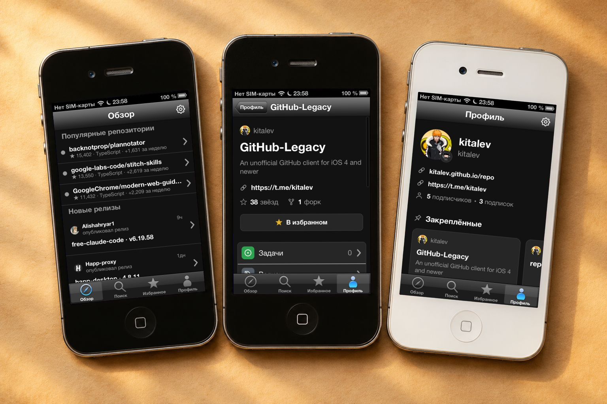

# Hi, I’m kitalev

I build native apps for older iPhones, iPads, and iPod touch devices. I write them in Objective-C and build them with Theos.

<p>
  <a href="https://t.me/kitalev"> Telegram</a>
  &nbsp;·&nbsp;
  <a href="https://github.com/kitalev/GitHub-Legacy"> GitHub Legacy</a>
  &nbsp;·&nbsp;
  <a href="https://github.com/kitalev/repo"> Package repo</a>
</p>

## GitHub Legacy

An unofficial, native GitHub client for older iOS devices. Browse repositories, read READMEs, keep up with issues and pull requests, and grab release files right from your device.

<p align="center">
  <a href="./github-legacy-showcase.png"></a>
</p>

[Download the latest release](https://github.com/kitalev/GitHub-Legacy/releases/latest) · [View source](https://github.com/kitalev/GitHub-Legacy)

## Package repo

Add this URL to your sources in Cydia or Sileo to install GitHub Legacy and get updates.

```text
https://kitalev.github.io/repo/
```

[Open the package repo](https://kitalev.github.io/repo/)
